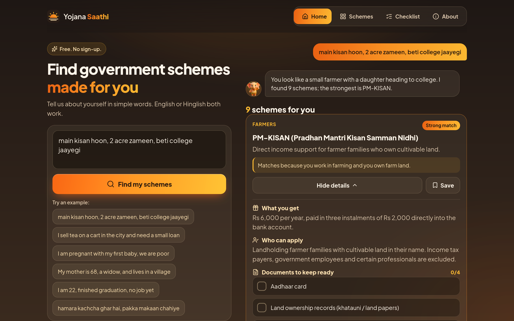
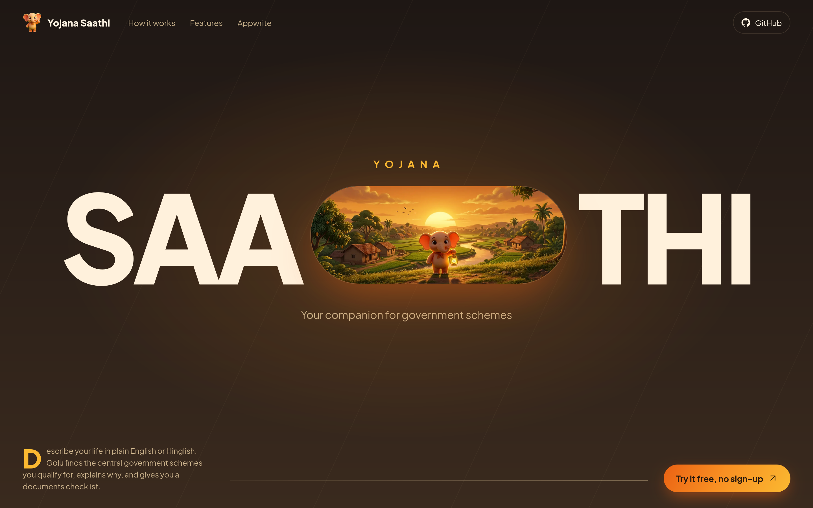
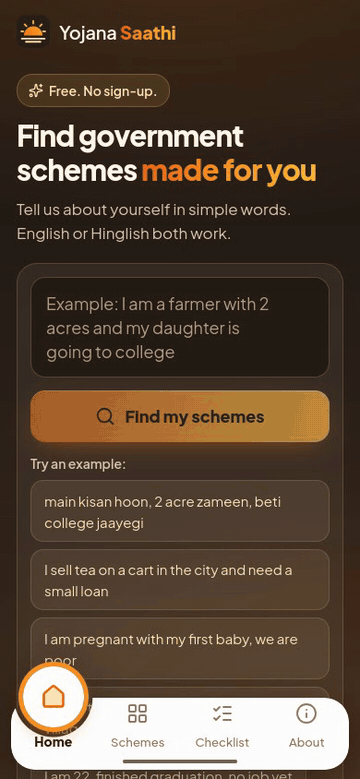
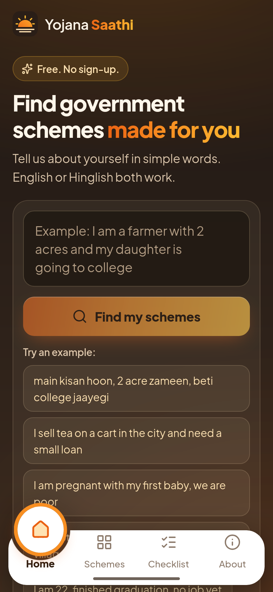
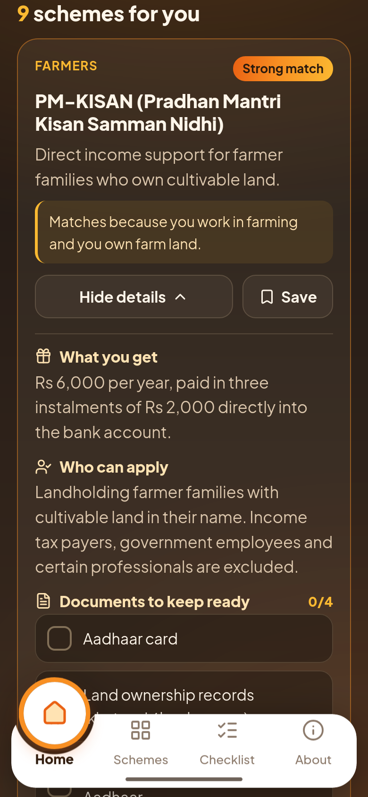
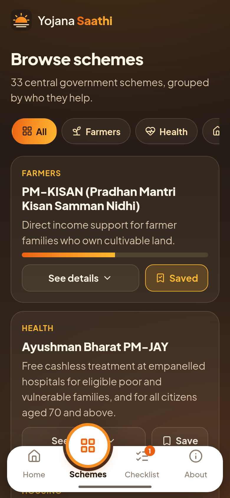
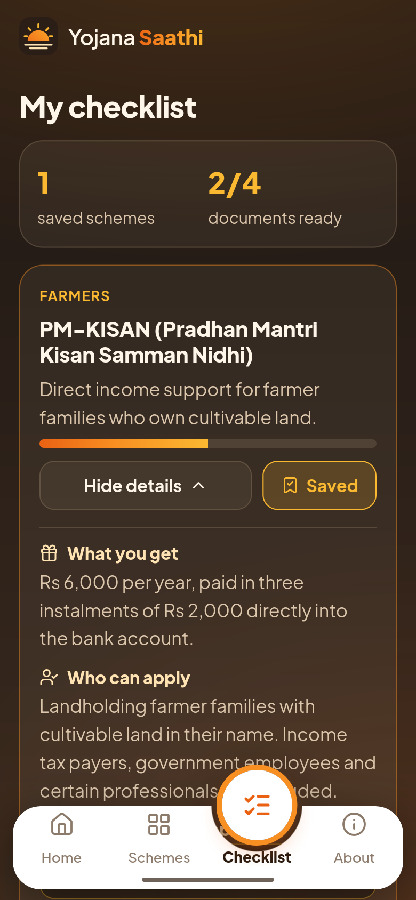
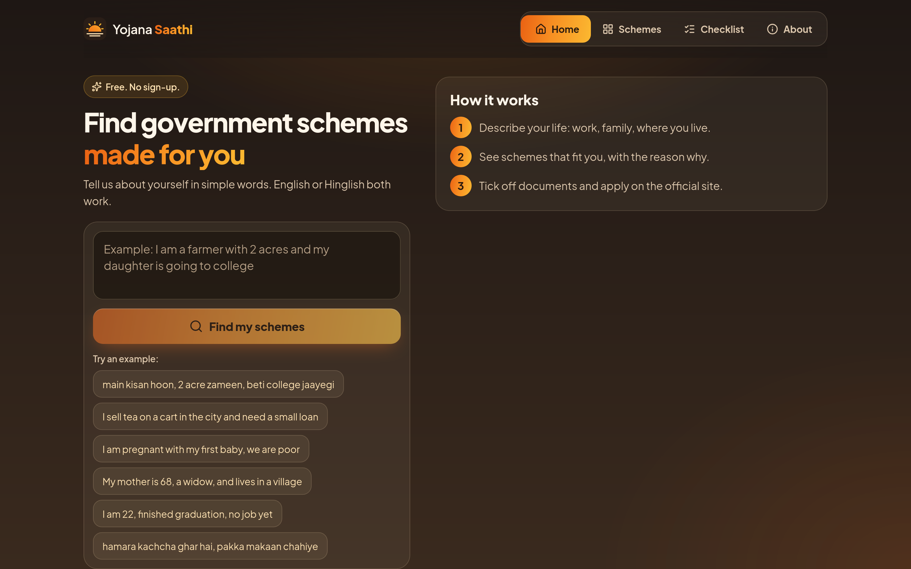
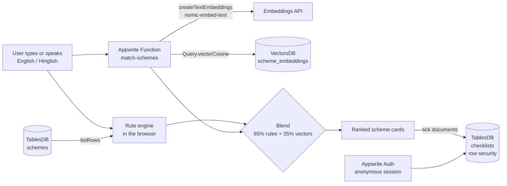

<div align="center">


<h3>Describe your life in plain words. Find the government schemes made for you.</h3>

<p>
  <a href="#getting-started"></a>
  
  
  
  
  <a href="LICENSE"></a>
</p>

<p>Built for the <b>Appwrite Databases Hackathon</b></p>



</div>

---

## Table of contents

- [The Problem](#the-problem)
- [The Solution](#the-solution)
- [Features](#features)
- [Demo](#demo)
- [How Appwrite Databases are used](#how-appwrite-databases-are-used)
- [Tech stack](#tech-stack)
- [Getting started](#getting-started)
- [Project structure](#project-structure)
- [Roadmap](#roadmap)
- [Contributing](#contributing)
- [License](#license)
- [Acknowledgements](#acknowledgements)

## The Problem

India runs hundreds of welfare schemes for farmers, women, students, workers, the elderly and people with disabilities. Yet many people who qualify never apply.

- **Information is scattered.** Each ministry has its own portal, rules and forms.
- **Eligibility is written in jargon.** "Landholding farmer families as per SECC deprivation criteria" means little to the person it is meant for.
- **Middlemen charge fees** for help that should be free.
- **Wasted trips.** People reach an office only to be sent back for a missing document.

## The Solution

**Yojana Saathi** ("scheme companion") lets anyone type, or speak, their situation the way they would tell a friend:

> *"main kisan hoon, 2 acre zameen, beti college jaayegi"*
> *(I am a farmer with 2 acres of land and my daughter is going to college)*

It returns the central schemes that fit, ranked by relevance, each with:

1. a one-line **why it matches** in plain English,
2. **what you get** and **who can apply**,
3. a **tickable document checklist** that is saved for later,
4. the **official apply link**, with a reminder that applying is free.

## Features

| | |
|---|---|
| **Plain-language and Hinglish search** | Rule-based profile extraction (occupation, gender, age, village or city, income hints, student, widow, disability, pregnancy, senior) with English and Hinglish synonyms. |
| **Semantic search (Appwrite mode)** | Appwrite's built-in `nomic-embed-text` embeddings + VectorsDB `Query.vectorCosine`, blended with the rule score. |
| **Explainable results** | Every card says why it matched, in simple words. |
| **Document checklist** | Tick what you have. Saved in `localStorage`, or synced to Appwrite TablesDB in a private anonymous session. |
| **Browse by category** | Farmers, Health, Housing, Women, Business, Pension, Education and more. |
| **Voice input** | Web Speech API (`en-IN`) where the browser supports it. |
| **Made for everyone** | Large text, big buttons, example chips you can tap, no sign-up. |
| **Sunset theme** | Warm dark UI, glass cards, raised-bubble bottom navigation on mobile, two-column layout on desktop. |
| **Landing page + app in one deploy** | `/` is an animated landing page (capsule hero, GSAP ScrollTrigger sections), `/app` is the app. A tiny router and Vercel SPA rewrites keep both on one Vite build. |
| **Thoughtful answers** | A short thinking state, a typed chat-style summary of what Golu understood ("You look like a small farmer with a daughter heading to college..."), then result cards streamed in one by one. |
| **Smooth, respectful motion** | GSAP page transitions, staggered cards, sliding nav bubble, count-up; disabled for `prefers-reduced-motion`. |

## Demo

> **Live demo:** https://yojana-saathi-beta.vercel.app (landing) and https://yojana-saathi-beta.vercel.app/app (the app, no sign-up)
>
> **Demo video (2:23):** [Watch / download](https://gofile.io/d/1dcCs3YE) <!-- YouTube link will replace this -->

**Demo clips** (also autoplaying in the landing page's "See it in action" section):
[desktop, 1440x900](public/videos/demo-desktop.mp4) · [mobile, 390x844](public/videos/demo-mobile.mp4).
Flow: Hinglish query, thinking state, typed reply, matched cards, PM-KISAN documents ticked and saved, Checklist, Schemes, then an English query.



<div align="center">

</div>

<table>
  <tr>
    <td align="center"><br/>Home</td>
    <td align="center"><br/>Results</td>
    <td align="center"><br/>Browse</td>
    <td align="center"><br/>Checklist</td>
  </tr>
</table>



## How Appwrite Databases are used



| Appwrite product | What it stores / does |
|---|---|
| **TablesDB** `yojana.schemes` | Scheme catalogue (name, ministry, category, benefits, eligibility, documents, links, age limits). Public read. |
| **TablesDB** `yojana.checklists` | One row per user and scheme with ticked documents. Row security: only the owner can read or update. |
| **VectorsDB** `yojana_vectors.scheme_embeddings` | One 768-dimension embedding per scheme, `metadata.schemeId` links back to the table row. |
| **Embeddings API** | `createTextEmbeddings` (`nomic-embed-text`) for both seeding and queries. |
| **Functions** `match-schemes` | Holds the server key, embeds the query and runs `Query.vectorCosine`. |
| **Auth** | Anonymous sessions, so nobody has to sign up. |

> **Note:** VectorsDB runs on a compute specification. Depending on your plan a dedicated tier may cost money. If VectorsDB is not available, the seed script skips it and the app keeps working on TablesDB + rule matching.

## Tech stack

| Area | Libraries (all open source) |
|---|---|
| UI | [React 19](https://react.dev), [Vite 8](https://vite.dev), [@vitejs/plugin-react](https://github.com/vitejs/vite-plugin-react) |
| Backend | [Appwrite](https://appwrite.io) Web SDK [`appwrite`](https://github.com/appwrite/sdk-for-web), server SDK [`node-appwrite`](https://github.com/appwrite/sdk-for-node) |
| Motion | [GSAP](https://gsap.com) + [@gsap/react](https://github.com/greensock/react) |
| Icons | [lucide-react](https://lucide.dev) |
| Font | [Plus Jakarta Sans](https://fontsource.org/fonts/plus-jakarta-sans) via `@fontsource` (self-hosted) |
| Testing | [Vitest](https://vitest.dev), [Playwright](https://playwright.dev) (screenshots and demo recording) |
| Tooling | [ffmpeg](https://ffmpeg.org) for the demo GIF |

## Getting started

### Demo mode (no keys, 1 minute)

```bash
git clone <your-fork-url> yojana-saathi
cd yojana-saathi
npm install
npm run dev        # open http://localhost:5173
npm test           # matching tests
```

### Appwrite mode

1. Create an Appwrite project and add a **Web platform** for your domain (e.g. `localhost`).
2. Enable **Anonymous** sign-in under Auth > Settings.
3. Create a server **API key** with these scopes:
   `databases.read` `databases.write` `tables.read` `tables.write` `columns.read` `columns.write` `indexes.read` `indexes.write` `rows.read` `rows.write` `vectorsdb.read` `vectorsdb.write` `collections.read` `collections.write` `documents.read` `documents.write` `embeddings.write`
4. Copy the env file and fill it in:
   ```bash
   cp .env.example .env
   ```
5. Seed the databases (creates TablesDB tables, the VectorsDB collection, rows and embeddings):
   ```bash
   npm run seed
   ```
6. Deploy `functions/match-schemes` (Node.js 22 runtime, entrypoint `src/main.js`, build command `npm install`) from the Console or the Appwrite CLI, with:
   - **Function ID:** `match-schemes`
   - **Scopes:** `embeddings.write` `vectorsdb.read` `collections.read` `documents.read`
   - **Execute access:** `any`
   - **Variables (optional):** `VECTORS_DB_ID`, `VECTORS_COLLECTION_ID`
7. Run `npm run dev`. The About tab shows "Connected to Appwrite" and results show a "Smart search" badge when vectors are used.

| Variable | Where | Required |
|---|---|---|
| `VITE_APPWRITE_ENDPOINT` | browser | yes (Appwrite mode) |
| `VITE_APPWRITE_PROJECT_ID` | browser | yes (Appwrite mode) |
| `VITE_APPWRITE_DATABASE_ID`, `VITE_APPWRITE_SCHEMES_TABLE`, `VITE_APPWRITE_CHECKLISTS_TABLE`, `VITE_APPWRITE_MATCH_FUNCTION_ID` | browser | no (defaults: `yojana`, `schemes`, `checklists`, `match-schemes`) |
| `APPWRITE_ENDPOINT`, `APPWRITE_PROJECT_ID`, `APPWRITE_API_KEY` | seed script only | yes (seeding) |
| `APPWRITE_VECTORSDB_SPEC`, `VECTORS_DB_ID`, `VECTORS_COLLECTION_ID` | seed script / function | no |

### Useful scripts

| Command | What it does |
|---|---|
| `npm run build` | Production build into `dist/` |
| `npm run screenshots` | Landing and app screenshots at 390x844 and 1440x900 into `docs/assets/` |
| `npm run demo` | Records the main flow and writes `docs/assets/demo.gif` (needs ffmpeg) |

## Project structure

```
yojana-saathi/
├── data/schemes.json              # 33 central schemes (source of truth for seeding)
├── functions/match-schemes/       # Appwrite Function: embeddings + VectorsDB search
├── scripts/
│   ├── seed.mjs                   # creates TablesDB + VectorsDB and seeds data
│   ├── screenshots.mjs            # Playwright screenshots
│   ├── demo-video.mjs             # Playwright demo recording (landing -> app flow)
│   ├── clean-frames.py            # drops half-painted frames from recordings
│   └── demo-gif.mjs               # Playwright video -> GIF
├── src/
│   ├── main.jsx                   # tiny router: "/" landing, "/app" app
│   ├── landing/                   # landing page (capsule hero, sections, demo videos)
│   ├── components/                # Nav, Home, Thinking, TypedText, SearchBox, SchemeCard, Browse, Checklist, About
│   ├── data/schemes.js            # bundled data + example queries
│   ├── lib/search/                # concepts (synonyms), matching, blending and reply summary
│   ├── lib/router.js              # navigate(), usePath(), <Link>
│   ├── lib/appwrite/              # TablesDB, Auth, Functions client
│   ├── lib/useChecklist.js        # localStorage + Appwrite sync
│   ├── lib/motion.js              # GSAP helpers, reduced-motion aware
│   └── styles.css                 # Sunset theme
├── tests/                         # Vitest matching + summary tests
├── vercel.json                    # SPA rewrites so /app works on refresh
└── docs/assets/                   # banner, screenshots, demo GIF
```

## Roadmap

- [ ] State government schemes, filterable by state
- [ ] Hindi and other Indian language UI (input already accepts Hinglish)
- [ ] Eligibility questions when a match is uncertain ("Do you pay income tax?")
- [ ] Offline-first PWA for low-connectivity areas
- [ ] Reminders for scheme deadlines and enrolment windows
- [ ] Nearest Common Service Centre (CSC) finder

## Contributing

Contributions are welcome.

1. Fork the repo and create a branch: `git checkout -b feat/my-change`
2. Run `npm test` and keep the tests green.
3. Use [Conventional Commits](https://www.conventionalcommits.org) (`feat:`, `fix:`, `docs:`, `test:`, `chore:`).
4. Open a pull request describing the change.

To add or correct a scheme, edit `data/schemes.json` and link the official source in `source_url`. Please only add facts you can verify on an official government site.

## License

[MIT](LICENSE) © 2026 Abhijeet kumar

## Acknowledgements

- [Appwrite](https://appwrite.io) for TablesDB, VectorsDB, Embeddings, Functions and Auth.
- [myScheme](https://www.myscheme.gov.in) and the official ministry portals linked on every card.
- Sunset palette and bottom navigation inspired by community designs on Pinterest.
- [GSAP](https://gsap.com), [Lucide](https://lucide.dev) and [Fontsource](https://fontsource.org).

> **Disclaimer:** Yojana Saathi is not a government service. Scheme details are general and can change. Always verify eligibility and amounts on the official website before applying.
